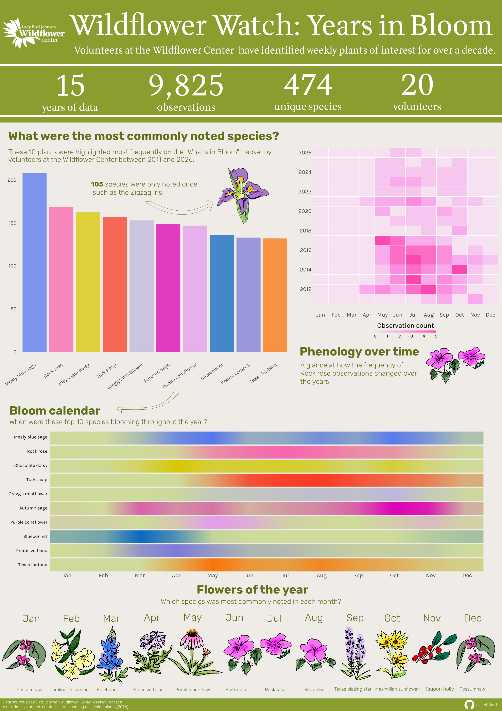

## Wildflower Watch: Years in Bloom

#### Exploring the "What's in Season" data, collected by volunteers at the Lady Bird Johnson Wildflower Center

The University of Texas at Austin Lady Bird Johnson Wildflower Center is the Botanic Garden of Texas, with a mission to inspire the conservation and cultivation of native plants. The Wildflower Center was founded by Lady Bird Johnson and Helen Hayes as the National Wildflower Research Center in 1982 and later renamed the Lady Bird Johnson Wildflower Center in 1997, and is a signature piece of Mrs. Johnson’s environmental legacy [@wildflowercenter]. 

```{r}
#| code-fold: TRUE
#| eval: true
#| echo: false
#| fig-align: "center"
#| out-width: "80%"
#| fig-cap: "Lady Bird Johnson- [@ladybirdday]"
#| fig-alt: "Image of Lady Bird Johnson perched on a rock"

```

As a native Texan, this project was especially meaningful to me. My grandmother used to take me to the Wildflower Center to watch the butterflies around the pollinator gardens as a child, and it was wonderful to be able to apply my education in plant science and data science to produce a visualization based around the same flowers and gardens. 

The data comes from the "What's in Season" tracker, a plant list of 1-24 species collected by approximately 20 volunteers at the Wildflower Center over a period of 15 years (2011 to present day). These plants were noted for being in bloom, growing, making seeds, or being otherwise noticeable. 

You can explore the "What's in Season" tracker [here](https://www.wildflower.org/whatsinseason).

```{r}
#| code-fold: TRUE
#| eval: true
#| echo: false
#| fig-align: "center"
#| out-width: "100%"
#| fig-alt: "Full infographic exploring wildflower diveristy."

```

If you would like to explore the code used to make these plots, see below!

```{r}
#| code-fold: TRUE
#| eval: FALSE
#| echo: TRUE

# Import libraries
library(tidyverse)
library(here)
library(ggplot2)
library(plotly)
library(showtext)
library(ggtext)

# Read in data 
bloom <- read_csv(here::here("data", "bloom_clean.csv"))

##~~~~~~~~~~~~~~~~~~~~~~~~~~~~~~~~~~~~~~~~~~~~~~~~~~~~~~~~~~~~~~~~~~~~~~~~~~~~~~
##                         Establish fonts and colors                       ----
##~~~~~~~~~~~~~~~~~~~~~~~~~~~~~~~~~~~~~~~~~~~~~~~~~~~~~~~~~~~~~~~~~~~~~~~~~~~~~~

# Add fonts
font_add_google(name = "Rubik", family = "rubik") # Headings and titles
font_add_google(name = "Karla", family = "karla") # Subtitles, axes, and captions
showtext_auto()

# Create color palette 
 bloom_palette <- c("Wildflower center green" = "#60721C", "White" = "#F9FAFA", "floral1" = "#EA71D5", "floral2" = "#F0A0C6", "floral3" = "#5F7ECB")
 
 # Select species colors for plot- color matche from flower images
species_colors <- c(
  "Turk's cap" = "#FA3B25",
  "Texas lantana" = "#F9740A",
  "Rock rose" = "#F865AE",
  "Purple coneflower" = "#E49CEC",
  "Prairie verbena" = "#7D7ADA",
  "Mealy blue sage" = "#5677EE",
  "Gregg's mistflower" = "#BDB7DB",
  "Chocolate daisy" = "#D9C703",
  "Bluebonnet" = "#0B67BF",
  "Autumn sage" = "#DE03B5"
)
 
 
# Create list of common names to pull from as-needed
 common_names <- tribble(
  ~scientific_name,                       ~common_name,
  "Salvia farinacea",                     "Mealy blue sage",
  "Pavonia lasiopetala",                  "Rock rose",
  "Berlandiera lyrata",                   "Chocolate daisy",
  "Malvaviscus arboreus var. drummondii", "Turk's cap",
  "Conoclinium dissectum",                "Gregg's mistflower",
  "Salvia greggii",                       "Autumn sage",
  "Echinacea purpurea",                   "Purple coneflower",
  "Lupinus texensis",                     "Bluebonnet",
  "Glandularia bipinnatifida",            "Prairie verbena",
  "Lantana urticoides",                   "Texas lantana",
  "Ilex decidua",                         "Possumhaw",
  "Gelsemium sempervirens",               "Carolina Jessamine",
  "Liatris punctata var. mucronata",      "Texas blazing star",
  "Senna lindheimeriana",                 "Lindheimer's senna",
  "Helianthus maximiliani",               "Maximilian sunflower",
  "Ilex vomitoria",                       "Yaupon holly",
  "Viguiera stenoloba",                   "Skeleton-leaf goldeneye"
)


##~~~~~~~~~~~~~~~~~~~~~~~~~~~~~~~~~~~~~~~~~~~~~~~~~~~~~~~~~~~~~~~~~~~~~~~~~~~~~~
##              Step 1: Collect statistics for use in header                ----
##~~~~~~~~~~~~~~~~~~~~~~~~~~~~~~~~~~~~~~~~~~~~~~~~~~~~~~~~~~~~~~~~~~~~~~~~~~~~~~

## Total species count 
# How many unique species were observed over the full time period?

# Count unique scientific names
totalspecies <- bloom %>% 
  summarise(unique_count = n_distinct(scientific_name))

#### Total observations
# How many plants were listed total over the full time period?

# Number of rows where scientific name is not NA
nrow(bloom %>% filter(!is.na(scientific_name)))

#### Number of plants observed once
# Unique observations
unique <- bloom %>%
  filter(!is.na(scientific_name)) %>%
  mutate(year = year(date)) %>%
  count(scientific_name) %>%
  filter(n == 1) %>%
  left_join(bloom %>% mutate(year = year(date)), by = "scientific_name") %>%
  select(scientific_name, year, n)

nrow(unique)

##~~~~~~~~~~~~~~~~~~~~~~~~~~~~~~~~~~~~~~~~~~~~~~~~~~~~~~~~~~~~~~~~~~~~~~~~~~~~~~
##                    Step 2: Bar plot of top species                       ----
##~~~~~~~~~~~~~~~~~~~~~~~~~~~~~~~~~~~~~~~~~~~~~~~~~~~~~~~~~~~~~~~~~~~~~~~~~~~~~~

## What were the top 10 most commonly noted plants over full time period?
# Top 10 most commonly noted plants over full data
top10 <- bloom %>%
  filter(!is.na(scientific_name)) %>%
  count(scientific_name) %>%
  slice_max(n, n = 10, with_ties = FALSE)

# Add common names for plotting
top10 <- top10 %>% 
  left_join(common_names, by = "scientific_name")

# Create bar plot
p1 <- ggplot(top10, aes(x = fct_reorder(common_name, n, .desc = TRUE), y = n, fill = common_name)) +
  geom_col(alpha = 0.75) +
  scale_fill_manual(values = species_colors, guide = "none") +
  labs(x = NULL,
       y = NULL) +
  theme_minimal(base_size = 12) +
  theme(
    plot.title = element_text(family = "rubik", face = "bold", size = rel(1.9), margin = margin(b = 6)),
    plot.subtitle = element_text(family = "karla", size = rel(1.2)),
    axis.text.x = element_text(angle = 35, hjust = 1, size = 12.5, family = "karla"),
    axis.text.y = element_text(size = 12.5, family = "karla"))

p1

ggsave(here("figures", "top10bar.pdf"), width = 10, height = 8, dpi = 150, bg = "white", device = cairo_pdf)

##~~~~~~~~~~~~~~~~~~~~~~~~~~~~~~~~~~~~~~~~~~~~~~~~~~~~~~~~~~~~~~~~~~~~~~~~~~~~~~
##                         Step 3: Phenology heatmap                        ----
##~~~~~~~~~~~~~~~~~~~~~~~~~~~~~~~~~~~~~~~~~~~~~~~~~~~~~~~~~~~~~~~~~~~~~~~~~~~~~~

## Are there any changing seasonal patterns in the most common species?

# Filter data to top 4 most common species
heatmap_data2 <- bloom %>% 
  filter(scientific_name %in% c("Pavonia lasiopetala")) %>% 
  mutate(year = year(date), month = month(date, label = TRUE)) %>% 
  count(scientific_name, year, month) %>%
  complete(scientific_name, year, month, fill = list(n = 0))

# Create heatmap
p2 <- ggplot(heatmap_data2, aes(x = month, y = year, fill = n)) +
  geom_tile(color = "white", linewidth = 0.5) +
  labs(fill = "Observation count",
       title = "**Rock rose** <span style='font-size:14pt'>*(Pavonia lasiopetala)*</span>") + 
  scale_fill_gradientn(colors = c("#f5e1f0", "#F89BEA", "#FC47B0")) +
  scale_y_continuous(breaks = seq(2012, 2026, by = 2)) +
  guides(fill = guide_colorbar(barwidth = 15, barheight = 0.75, title.position = "top")) +
  scale_x_discrete(expand = c(0, 0)) +
  theme_minimal() +
  theme(
    legend.position = "bottom",
    legend.title = element_text(family = "karla", hjust = 0.5),
    axis.title = element_blank(),
    panel.grid = element_blank(),
    axis.text.x = element_text(family = "karla"),
    plot.title = element_markdown(family = "rubik", size = rel(1.8), margin = margin(b = 6)),
    plot.subtitle = element_text(family = "karla", size = rel(1.2)),
  )

p2

ggsave(here("figures", "heatmap2.pdf"), width = 10, height = 10, dpi = 150, bg = "white")

##~~~~~~~~~~~~~~~~~~~~~~~~~~~~~~~~~~~~~~~~~~~~~~~~~~~~~~~~~~~~~~~~~~~~~~~~~~~~~~
##                      Step 4: Bloom calendar heatmap                      ----
##~~~~~~~~~~~~~~~~~~~~~~~~~~~~~~~~~~~~~~~~~~~~~~~~~~~~~~~~~~~~~~~~~~~~~~~~~~~~~~

## When were the top 10 most common plants blooming throughout the year?

# Count of observations of each species each month
species_month_counts <- bloom %>%
  mutate(month = month(date, label = TRUE)) %>%
  count(scientific_name, month)

# Fill all missing months with 0
species_month_counts <- species_month_counts %>%
  complete(scientific_name, month, fill = list(n = 0))

# Filter to just top 10 most common species
species_month_counts <- species_month_counts %>%
  filter(scientific_name %in% top10$scientific_name) %>%
  left_join(common_names, by = "scientific_name")

# Design heatmap with color edits
species_month_counts <- species_month_counts %>%
  mutate(common_name = fct_reorder(common_name, n, .fun = sum, .desc = TRUE)) %>% 
  group_by(common_name) %>%
  mutate(
    tile_color = {
      ramp <- colorRampPalette(c("#cfdb9a", species_colors[as.character(common_name[1])]))
      ramp(100)[as.integer(scales::rescale(n, to = c(1, 100)))]
    }
  ) %>%
  ungroup()

ggplot(species_month_counts, aes(x = as.numeric(month), y = 1, fill = tile_color)) +
  geom_raster(interpolate = TRUE) +
  scale_fill_identity() +
  facet_wrap(~common_name, ncol = 1, strip.position = "left") +
  scale_x_continuous(breaks = 1:12, labels = month.abb, expand = c(0, 0)) +
  theme_minimal() +
  theme(
    axis.text.x = element_text(size = 16, family = "karla"),
    axis.text.y = element_blank(),
    axis.ticks.y = element_blank(),
    strip.text.y.left = element_text(angle = 0, hjust = 1, size = 13, family = "karla"),
    panel.spacing = unit(0, "lines")
  ) +
  labs(x = NULL, y = NULL)

 ggsave(here("figures", "seasonalheatmap2.pdf"), width = 19, height = 6, dpi = 150)
 
##~~~~~~~~~~~~~~~~~~~~~~~~~~~~~~~~~~~~~~~~~~~~~~~~~~~~~~~~~~~~~~~~~~~~~~~~~~~~~~
##                    Step 5: Plot of monthly plants                        ----
##~~~~~~~~~~~~~~~~~~~~~~~~~~~~~~~~~~~~~~~~~~~~~~~~~~~~~~~~~~~~~~~~~~~~~~~~~~~~~~

## What were the most commonly observed plants in each month of the year?

# Most observed plants each month (2011-2026)
top_by_month <- bloom %>%
  filter(!is.na(scientific_name)) %>%
  mutate(month = month(date, label = TRUE)) %>%
  count(month, scientific_name) %>%
  group_by(month) %>%
  slice_max(n, n = 1, with_ties = TRUE) %>%
  ungroup()

top_by_month <- top_by_month %>% 
  left_join(common_names, by = "scientific_name")

```
